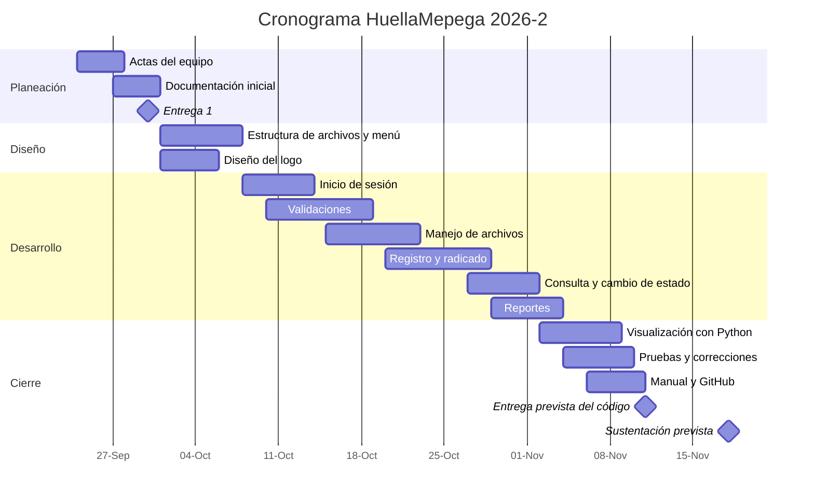

# HuellaMepega — Gestor de PQRS


## Información académica

- **Universidad:** Universidad de Antioquia.
- **Facultad:** Ingeniería.
- **Departamento:** Ingeniería Industrial.
- **Asignatura:** Algoritmia y Programación.
- **Semestre:** 2026-2.
- **Docente:** Victor Hugo Mercado Ramos.


## Integrantes

| Nombre completo | Programa académico | Correo institucional |
|---|---|---|
| Juan Manuel Echeverri Idarraga | Ingeniería Industrial | j.echeverri@udea.edu.co |
| Jhon Fredis Córdoba Aragón | Ingeniería Industrial | jhon.cordoba1@udea.edu.co |

### Juan Manuel Echeverri Idarraga

- **Rol:** Líder del proyecto y administrador del repositorio.
- **Programa académico:** Ingeniería Industrial.
- **Habilidades:** Programación en Python y trabajo en equipo.
- **Fortalezas:** Organización y liderazgo.

### Jhon Fredis Córdoba Aragón

- **Programa académico:** Ingeniería Industrial.
- **Habilidades:** Análisis de datos, optimización de operaciones y modelado de sistemas.
- **Fortalezas:** Pensamiento analítico y resolución de problemas complejos.

### Descripción del equipo

Somos estudiantes de Ingeniería Industrial de la Universidad de Antioquia. Nuestro proyecto busca aplicar los conocimientos adquiridos en Algoritmia y Programación al desarrollo de una herramienta que facilite la gestión y el seguimiento de las PQRS relacionadas con la atención y el bienestar de las mascotas en la comunidad universitaria.


## Descripción del proyecto

HuellaMepega es un sistema académico desarrollado en Python para gestionar peticiones, quejas, reclamos y sugerencias (PQRS) relacionadas con la atención y el bienestar de las mascotas.

El sistema permite registrar, consultar y actualizar solicitudes, generar comprobantes de radicación y obtener indicadores estadísticos que facilitan el seguimiento de los casos.

Cuenta con una interfaz de consola (CLI) y una interfaz gráfica desarrollada con Flet.


## Reporte de visión

### Planteamiento del problema

MEPEGA recibe peticiones, quejas, reclamos y sugerencias
relacionadas con la atención y el bienestar de las mascotas
a través de diferentes canales de comunicación.

El registro manual de estas solicitudes puede ocasionar:

- Pérdida de información.
- Duplicación de números de radicado.
- Dificultades para realizar el seguimiento de las solicitudes.
- Incumplimiento de los plazos de respuesta.
- Falta de información estadística para la toma de decisiones.

### Solución propuesta

HuellaMepega es una aplicación desarrollada en Python que
permite sistematizar el registro, consulta, seguimiento y
análisis de las PQRS mediante una interfaz de consola y
una interfaz gráfica desarrollada con Flet.

### Objetivo general

Desarrollar un sistema informático en Python que permita
a MEPEGA gestionar sus PQRS de manera organizada, segura
y trazable, utilizando archivos planos y herramientas
de análisis de datos.

### Objetivos específicos

1. Controlar el acceso mediante la autenticación de usuarios.
2. Registrar las PQRS aplicando validaciones de datos.
3. Generar identificadores consecutivos e independientes.
4. Generar comprobantes de radicación en formato TXT.
5. Controlar los plazos de respuesta y las alertas de vencimiento.
6. Registrar automáticamente las fechas reales de respuesta.
7. Generar estadísticas y visualizaciones mediante Python.
8. Facilitar el seguimiento de las solicitudes y la toma de decisiones.

### Usuarios del sistema

| Usuario | Responsabilidad |
|---|---|
| Administrador u operador | Registrar, consultar, actualizar y analizar las PQRS. |
| Estudiante | Presentar solicitudes y recibir el radicado. |
| Docente | Presentar solicitudes y recibir el radicado. |
| Administrativo | Presentar solicitudes y recibir el radicado. |
| Ciudadano | Presentar solicitudes y recibir el radicado. |

Los solicitantes no interactúan directamente con el programa.
El operador autorizado registra sus solicitudes.

### Beneficios

- Organización de la información.
- Control de los tiempos de respuesta.
- Reducción de errores de registro.
- Trazabilidad de las solicitudes.
- Disponibilidad de indicadores estadísticos.
- Apoyo a la toma de decisiones.

### Alcance

**Incluye:**

- Autenticación de usuarios.
- Registro, consulta y actualización de PQRS.
- Almacenamiento en archivos planos.
- Generación de radicados TXT.
- Interfaz de consola e interfaz gráfica Flet.
- Estadísticas mediante Pandas y NumPy.
- Visualizaciones mediante Matplotlib.
- Pruebas automatizadas.
- Base sintética de demostración.

**No incluye:**

- Aplicaciones móviles.
- Servicios web.
- Envío automático de correos electrónicos.
- Bases de datos en la nube.
- Procesamiento concurrente desde múltiples instancias.
- Implementación de Power BI.


## Funcionalidades

- Autenticación mediante usuario o correo institucional simulado.
- Bloqueo temporal después de tres intentos fallidos.
- Registro y validación de solicitudes.
- Generación automática de identificadores.
- Consulta de PQRS por tipo e identificador.
- Generación de comprobantes TXT de 120 caracteres por línea.
- Actualización de estados: Registrada, En proceso y Solucionada.
- Registro automático de la fecha real de respuesta.
- Identificación de solicitudes vencidas y próximas a vencer.
- Generación de estadísticas y gráficas.
- Cierre de sesión.


## Especificación de requisitos

### Requisitos funcionales

| ID | Requisito | Descripción |
|---|---|---|
| RF-01 | Iniciar sesión | Autenticar mediante usuario o correo institucional simulado y contraseña. |
| RF-02 | Bloqueo de seguridad | Bloquear el acceso durante 10 segundos después de tres intentos fallidos. |
| RF-03 | Sesión activa | Asociar automáticamente el usuario autenticado a cada solicitud registrada. |
| RF-04 | Menú principal | Presentar las opciones de registro, consulta, actualización, estadísticas y salida. |
| RF-05 | Registrar PQRS | Capturar y almacenar los datos del solicitante y de la solicitud. |
| RF-06 | Validación de datos | Comprobar formatos, longitudes, obligatoriedad y categorías permitidas. |
| RF-07 | Identificadores | Generar identificadores consecutivos e independientes por tipo de PQRS. |
| RF-08 | Almacenamiento | Guardar las solicitudes en cuatro archivos TXT independientes. |
| RF-09 | Plazo de respuesta | Calcular la fecha máxima de respuesta sumando 30 días calendario a la fecha de registro. |
| RF-10 | Radicado | Generar comprobantes TXT de 120 caracteres por línea, sin incluir la descripción detallada. |
| RF-11 | Consultar PQRS | Buscar solicitudes por tipo e identificador. |
| RF-12 | Cambiar estado | Permitir únicamente la transición Registrada → En proceso → Solucionada. |
| RF-13 | Estadísticas | Calcular indicadores de respuesta, distribución, resolución, antigüedad y vencimiento. |
| RF-14 | Exportar resultados | Generar reportes CSV, TXT y nueve gráficas PNG mediante Python. |
| RF-15 | Cerrar sesión | Finalizar la sesión activa o salir del programa de forma ordenada. |
| RF-16 | Fecha de respuesta | Registrar automáticamente la fecha real al solucionar una PQRS. |
| RF-17 | Interfaz gráfica | Permitir la gestión de solicitudes mediante Flet. |
| RF-18 | Modo de demostración | Permitir pruebas con una base sintética independiente de los registros históricos. |

### Requisitos no funcionales

| ID | Categoría | Descripción |
|---|---|---|
| RNF-01 | Usabilidad | Proporcionar interfaces claras, menús organizados y mensajes de validación. |
| RNF-02 | Seguridad | Restringir el acceso a usuarios activos y autorizados. |
| RNF-03 | Confidencialidad | Proteger las contraseñas mediante PBKDF2 y ocultarlas durante la autenticación. |
| RNF-04 | Integridad | Evitar identificadores duplicados dentro de una misma categoría. |
| RNF-05 | Persistencia | Conservar los registros después de finalizar el programa. |
| RNF-06 | Rendimiento | Establecer como objetivo un tiempo inferior a dos segundos para las operaciones de registro y consulta. |
| RNF-07 | Compatibilidad | Utilizar Python 3.12 o 3.13, con funcionamiento comprobado en Windows y pruebas previas de consola en Linux. |
| RNF-08 | Mantenibilidad | Organizar el código en módulos y funciones reutilizables. |
| RNF-09 | Portabilidad | Utilizar rutas relativas y archivos planos independientes del computador. |
| RNF-10 | Gestión temporal | Utilizar datetime para el procesamiento de fechas y plazos. |
| RNF-11 | Verificabilidad | Incorporar pruebas automatizadas mediante unittest. |
| RNF-12 | Trazabilidad | Conservar el identificador, usuario registrador, fechas y estado de cada solicitud. |

### Actualización del alcance

Respecto a la planificación inicial, la implementación
actual incorpora los siguientes ajustes:

- Bloqueo temporal configurado en 10 segundos.
- Plazo máximo de respuesta configurado en 30 días calendario.
- Generación de estadísticas y gráficas mediante Python.
- Incorporación de una interfaz gráfica desarrollada con Flet.
- Implementación de una base de demostración independiente.
- Incorporación de pruebas automatizadas.

El enfoque de visualización se desarrolla en Python de
acuerdo con el derrotero técnico de la segunda entrega.

El objetivo de rendimiento inferior a dos segundos y la
compatibilidad integral con macOS quedan pendientes de
verificación específica.


## Plan de proyecto

El desarrollo de HuellaMepega se organizó mediante una
planificación de actividades orientadas al diseño,
programación, documentación y verificación del sistema.

### Planificación de actividades

| N.º | Actividad | Descripción | Horas previstas |
|---|---|---|---:|
| 1 | Planeación y actas | Organización del equipo y acuerdos de trabajo. | 4 |
| 2 | Documentación inicial | Integrantes, visión, requisitos, licencia y planificación. | 6 |
| 3 | Diseño | Estructura de archivos, menú e identidad visual. | 4 |
| 4 | Autenticación | Inicio de sesión y bloqueo de seguridad. | 4 |
| 5 | Validaciones | Desarrollo del módulo validaciones.py. | 5 |
| 6 | Archivos | Desarrollo del almacenamiento y persistencia. | 4 |
| 7 | Registro y radicado | Registro de solicitudes y generación de comprobantes. | 5 |
| 8 | Consulta y actualización | Búsqueda de solicitudes y cambios de estado. | 3 |
| 9 | Reportes y visualización | Estadísticas y gráficas mediante Python. | 6 |
| 10 | Pruebas | Verificación del funcionamiento y corrección de errores. | 4 |
| 11 | Manual y GitHub | Documentación y organización del repositorio. | 5 |
| | **Total** | | **50** |

### Cronograma de Gantt

El siguiente cronograma conserva las fechas de planificación
de la primera entrega, con la actualización del enfoque
de visualización estadística mediante Python.



### Actualización del cronograma

De acuerdo con el derrotero de la segunda entrega, la
sustentación está programada para el 26 de noviembre de 2026.

El 25 de noviembre de 2026 se realizaron comprobaciones
funcionales de la interfaz gráfica y de consola, ajustes
en la presentación de los radicados, pruebas automatizadas
de regresión y actualización de la documentación técnica.

Las 15 pruebas automatizadas finalizaron satisfactoriamente.

Las fechas del cronograma corresponden a la planificación
original y no constituyen un registro certificado de las
horas efectivamente trabajadas.


### Presupuesto del proyecto

El presupuesto de HuellaMepega se estima considerando
el tiempo de práctica de formación invertido en la
planeación, desarrollo, documentación y verificación
del sistema.

De acuerdo con los lineamientos del proyecto integrador,
se consideran 50 horas totales de trabajo del equipo,
valoradas con referencia a un salario mínimo legal
mensual vigente (SMLV).

#### Datos base

- Salario mensual de referencia: $1.750.905 COP.
- Base mensual de cálculo presupuestal: 210 horas.
- Valor estimado por hora: $8.338 COP.
- Horas totales previstas: 50.
- Moneda: pesos colombianos (COP).

#### Distribución del presupuesto

| Concepto | Horas | Valor por hora | Subtotal |
|---|---:|---:|---:|
| Planeación y documentación | 10 | $8.338 | $83.380 |
| Diseño del sistema | 4 | $8.338 | $33.352 |
| Desarrollo del programa | 21 | $8.338 | $175.098 |
| Reportes y visualización | 6 | $8.338 | $50.028 |
| Pruebas y correcciones | 4 | $8.338 | $33.352 |
| Manual y GitHub | 5 | $8.338 | $41.690 |
| **Total** | **50** | | **$416.900** |

#### Recursos tecnológicos

| Recurso | Costo adicional previsto |
|---|---:|
| Computadores personales | $0 |
| Python | $0 |
| Visual Studio Code | $0 |
| Pandas | $0 |
| NumPy | $0 |
| Matplotlib | $0 |
| Flet | $0 |
| Git y GitHub | $0 |

#### Costo total estimado

El presupuesto total estimado del proyecto es de
**$416.900 COP**, correspondiente a la valoración
de las 50 horas de trabajo previstas.

Este presupuesto representa una estimación académica
del tiempo de formación, no un desembolso efectivo
de dinero ni una certificación de horas trabajadas.

La tarifa utilizada conserva el criterio presupuestal
establecido en la planificación de la primera entrega.


## Plan de versionado

El proyecto HuellaMepega utiliza Git y GitHub como
herramientas de control de versiones para conservar
el historial de modificaciones y facilitar el trabajo
colaborativo.

### Estrategia de versionado

Se establece el siguiente esquema de identificación
de versiones:

- Versiones mayores: cambios importantes en las funcionalidades.
- Versiones menores: incorporación de nuevos módulos y mejoras.
- Versiones de corrección: solución de errores y ajustes técnicos.

Cada modificación relevante debe registrarse mediante
un commit con una descripción clara de los cambios.

### Historial de desarrollo

| Fecha | Versión de referencia | Actividad | Estado |
|---|---|---|---|
| 27/09/2026 | v0.1.0 | Publicación del README con los puntos 1 a 7 de la primera entrega y actualizaciones documentales. | Publicado |
| 28/09/2026 | v0.1.1 | Actualizaciones del README. | Publicado |
| 29/09/2026 | v0.1.2 | Modificación de la documentación inicial. | Publicado |
| 30/09/2026 | v0.2.0 | Actualizaciones del README, carga de archivos y ajuste del nombre del logo. | Publicado |
| 01/10/2026 | v0.2.1 | Actualización del README. | Publicado |
| 24/11/2026 | v0.2.2 | Actualización de la información de los integrantes. | Publicado |
| 25/11/2026 | v0.9.0 | Verificación funcional, correcciones finales, pruebas de regresión y actualización documental. | Verificado localmente |
| Pendiente de publicación | v1.0.0 | Integración del código fuente, datos, documentación, pruebas y dependencias. | Previsto |
| 26/11/2026 | v1.0.0 | Sustentación académica del proyecto. | Programado |

Las versiones anteriores constituyen una clasificación
documental de los hitos del proyecto. No representan
etiquetas o releases creados previamente en GitHub.

### Historial de commits originales

| Fecha | Cuenta de GitHub | Identificador | Descripción |
|---|---|---|---|
| 27/09/2026 | MariACEVEDO-crypto | e67deb8 | Entrega 1: README con puntos 1 a 7 |
| 27/09/2026 | MariACEVEDO-crypto | 54c59d1 | Update README.md |
| 27/09/2026 | MariACEVEDO-crypto | 9ebd593 | Update README.md |
| 28/09/2026 | jecheverri-dot | 1143f42 | Update README.md |
| 28/09/2026 | jhoncordoba1-alt | f663828 | Update README.md |
| 29/09/2026 | jhoncordoba1-alt | 873722a | Update README.md |
| 30/09/2026 | jhoncordoba1-alt | d37e1f1 | Update README.md |
| 30/09/2026 | jhoncordoba1-alt | a20bbdd | Update README.md |
| 30/09/2026 | jecheverri-dot | ebdfafa | Update README.md |
| 30/09/2026 | jecheverri-dot | 2215d04 | Add files via upload |
| 30/09/2026 | jecheverri-dot | b206d47 | Rename logo.png.jpg to logo.png |
| 30/09/2026 | jecheverri-dot | a4b6e79 | Update README.md |
| 30/09/2026 | jecheverri-dot | 359d5e5 | Update README.md |
| 30/09/2026 | jecheverri-dot | f6410e2 | Update README.md |
| 30/09/2026 | jecheverri-dot | b084101 | Update README.md |
| 01/10/2026 | jhoncordoba1-alt | e72e2dc | Update README.md |
| 24/11/2026 | jecheverri-dot | 5af7887 | Update team member details in README |

### Registro de contribuciones

Antes de la publicación de la segunda entrega,
el repositorio presenta las siguientes contribuciones:

| Cuenta de GitHub | Commits |
|---|---:|
| jecheverri-dot | 9 |
| jhoncordoba1-alt | 5 |
| MariACEVEDO-crypto | 3 |
| **Total** | **17** |

La cantidad de commits representa las modificaciones
registradas en el repositorio y no constituye una
medición individual de las horas trabajadas.

### Versión final prevista — v1.0.0

La versión final integra:

- Interfaz de consola.
- Interfaz gráfica mediante Flet.
- Autenticación y bloqueo temporal.
- Registro, consulta y actualización de PQRS.
- Base histórica de 12.000 registros sintéticos.
- Base de demostración independiente.
- Radicados TXT de 120 caracteres por línea.
- Estadísticas y reportes mediante Python.
- Nueve visualizaciones gráficas.
- Documentación técnica.
- Manual de usuario.
- Informe de pruebas.
- Suite de 15 pruebas automatizadas superadas.
- Licencia CC BY-NC-SA 4.0.

### Trazabilidad del proyecto

El historial original de modificaciones puede consultarse
en el siguiente enlace:

[Historial de commits de HuellaPQRS](https://github.com/MariACEVEDO-crypto/HuellaPQRS/commits/main/)

La publicación de la versión final conservará el historial
anterior del repositorio.


## Tecnologías utilizadas

- Python.
- Pandas.
- NumPy.
- Matplotlib.
- Flet.
- Archivos planos TXT.
- Archivos CSV.
- Visual Studio Code.
- Git y GitHub.
- Unittest.

## Estructura del proyecto

| Carpeta o archivo | Descripción |
|---|---|
| src/ | Código fuente y módulos del sistema. |
| data/ | Registros, usuarios, reportes y gráficas. |
| docs/ | Documentación técnica y manual de usuario. |
| images/ | Logo e identidad visual. |
| tests/ | Pruebas automatizadas. |
| README.md | Información general del proyecto. |
| LICENSE | Licencia del proyecto. |
| requirements.txt | Dependencias de Python. |
| .gitignore | Exclusión de archivos temporales. |

## Instalación

Extraer la carpeta completa del proyecto y abrirla en Visual Studio Code.

Se recomienda utilizar Python 3.12 o 3.13 y un entorno virtual independiente.

Instalar las dependencias desde la terminal:

```bash
python -m pip install -r requirements.txt
```

### Ejecución de la interfaz gráfica

```bash
python src/main.py
```

### Ejecución de la consola

```bash
python src/main.py --consola
```

## Acceso a la base histórica sintética

- Usuario: `admin_udea`
- Contraseña: `Kc8mXsGreveoYXJtlni3hA`
- Alias de correo simulado: `demo.huellamepega@udea.edu.co`

Las credenciales son exclusivamente académicas y de demostración. No corresponden a cuentas institucionales reales ni deben utilizarse en producción.

Las contraseñas se almacenan mediante hashes PBKDF2 con sal aleatoria.

## Modo de demostración

El sistema dispone de una base sintética independiente para realizar pruebas sin modificar los 12.000 registros históricos.

Para ejecutar la demostración gráfica:

```bash
python src/main.py --demo
```

Para ejecutar la demostración en consola:

```bash
python src/main.py --consola --demo
```

Credenciales de demostración:

- Usuario: `demo_operador`
- Contraseña: `HuellaDemo!SoloEnsayo26`
- Alias simulado: `demo.operador@udea.edu.co`

## Gestión de datos

La base histórica contiene 12.000 registros sintéticos distribuidos de la siguiente manera:

| Tipo de PQRS | Cantidad |
|---|---:|
| Peticiones | 3.000 |
| Quejas | 3.000 |
| Reclamos | 3.000 |
| Sugerencias | 3.000 |
| **Total** | **12.000** |

El sistema utiliza archivos planos independientes para almacenar cada categoría de solicitud.

El plazo máximo de respuesta configurado es de 30 días calendario, con alertas para solicitudes próximas a vencer dentro de cinco días.

Las fechas históricas de respuesta y los perfiles de solicitantes desconocidos se conservan sin información. Estos datos no se inventan ni se utilizan para calcular indicadores sin suficiente evidencia.

## Estadísticas e indicadores

El sistema permite analizar:

- Promedio real de días de respuesta.
- Distribución por tipo de mascota.
- Canales de recepción.
- Distribución por campus.
- Estados de las solicitudes.
- Tipos de PQRS.
- Documentos de identidad.
- Perfil del solicitante.
- Cantidad de registros por usuario.
- Solicitudes vencidas y próximas a vencer.
- Solicitudes activas más antiguas.

Las gráficas se generan mediante Matplotlib y se exportan en formato PNG.

## Pruebas de funcionamiento

El proyecto incluye pruebas automatizadas que pueden ejecutarse mediante:

```bash
python -m unittest discover -s tests -v
```

La versión definitiva original superó 15 pruebas automatizadas.

El 25 de noviembre de 2026 se realizaron comprobaciones funcionales en Windows con Python 3.12, utilizando la interfaz gráfica Flet y la consola CLI.

Se verificaron el inicio de sesión, registro, consulta, cambios de estado, bloqueo temporal, estadísticas y generación de gráficas.

Durante las pruebas se agregó una solicitud a la base de demostración, obteniendo los siguientes resultados:

| Indicador | Resultado |
|---|---:|
| Solicitudes totales | 9 |
| Solicitudes activas | 4 |
| Solicitudes solucionadas | 5 |
| Promedio de respuesta antes del redondeo | 2,2007 días |
| Promedio de respuesta redondeado | 2 días |
| Porcentaje de resolución | 55,56 % |

También se verificó un comprobante de radicación compuesto por 25 líneas de exactamente 120 caracteres cada una.

Estos resultados corresponden a pruebas con datos sintéticos, no a solicitudes veterinarias reales.

## Documentación

- [Manual de usuario](docs/manual_de_usuario.md)
- [Documentación técnica](docs/documentacion_tecnica.md)
- [Informe de pruebas](docs/informe_pruebas.md)

## Alcance académico

El proyecto se desarrolla en Python y utiliza las herramientas de programación y análisis de datos contempladas en el enfoque técnico de la segunda entrega.

Se utilizó inteligencia artificial como herramienta de apoyo para la revisión, corrección y documentación del código, complementada con comprobaciones funcionales realizadas por el estudiante.

## Repositorio

[GitHub — HuellaPQRS](https://github.com/MariACEVEDO-crypto/HuellaPQRS)

## Licencia

Este proyecto se publica bajo la licencia **Creative Commons Atribución-NoComercial-CompartirIgual 4.0 Internacional (CC BY-NC-SA 4.0)**.

La licencia permite compartir y adaptar el material bajo las siguientes condiciones:

- **Atribución (BY):** reconocer a los autores del proyecto.
- **No comercial (NC):** no utilizar el material con fines comerciales.
- **Compartir igual (SA):** distribuir las adaptaciones bajo la misma licencia.

El proyecto tiene fines académicos y educativos.

Para más información, consulte el archivo [LICENSE](LICENSE) o la [licencia oficial](https://creativecommons.org/licenses/by-nc-sa/4.0/).

---

**HuellaMepega — Universidad de Antioquia, 2026-2.**