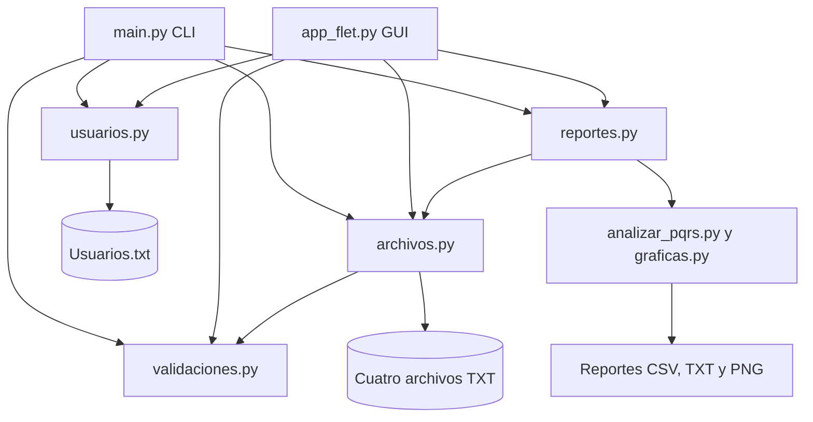
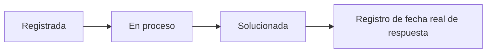

# Documentación técnica — HuellaMepega

## 1. Información general

- **Proyecto:** HuellaMepega — Gestor de PQRS.
- Universidad de Antioquia.
- **Asignatura:** Algoritmia y Programación.
- **Semestre:** 2026-2.

## 2. Visión funcional

HuellaMepega es una aplicación académica orientada a la gestión de peticiones, quejas, reclamos y sugerencias relacionadas con el bienestar y la atención de mascotas.

El sistema busca facilitar el registro, almacenamiento, consulta, seguimiento y análisis de solicitudes mediante herramientas de programación en Python.

La aplicación cuenta con dos interfaces de usuario: una versión de consola (CLI) y una interfaz gráfica desarrollada con Flet. Ambas comparten los mismos módulos de almacenamiento, autenticación, validación y procesamiento estadístico.

Esta descripción corresponde a la visión funcional del software y no sustituye el reporte de visión académico de la primera entrega.

## 3. Arquitectura del sistema

El proyecto utiliza una arquitectura modular que permite distribuir las responsabilidades del programa y reutilizar funciones.



## 4. Descripción de los módulos

| Módulo | Responsabilidad |
|---|---|
| main.py | Control de la consola, autenticación, menú principal y operaciones sobre PQRS. |
| app_flet.py | Interfaz gráfica, formularios y gestión de eventos. |
| archivos.py | Lectura, escritura, consulta, identificadores, actualización de registros y radicados. |
| validaciones.py | Validación de campos, categorías, fechas y transiciones de estado. |
| usuarios.py | Administración de usuarios, autenticación, protección de contraseñas y control de intentos. |
| reportes.py | Cálculo centralizado de estadísticas e indicadores. |
| analizar_pqrs.py | Consolidación de información mediante Pandas y exportación de reportes. |
| graficas.py | Generación de nueve gráficas estadísticas en formato PNG mediante Matplotlib. |
| generar_datos.py | Generación de datos sintéticos en una ubicación independiente. |
| migrar_datos.py | Migración controlada de la estructura de datos. |
| rutas.py | Selección de la base histórica o de demostración. |
| preparar_demostracion.py | Creación reproducible de ocho casos sintéticos iniciales. |
| tests/ | Pruebas automatizadas mediante unittest. |

## 5. Modelo de datos

El sistema almacena las solicitudes en cuatro archivos planos independientes:

- Peticion.txt
- Queja.txt
- Reclamo.txt
- Sugerencia.txt

Cada archivo utiliza la misma estructura de 21 campos.

| Campo | Descripción |
|---|---|
| id | Identificador consecutivo por tipo de solicitud. |
| nombre_completo | Nombre del solicitante. |
| tipo_documento | Categoría del documento de identidad. |
| numero_documento | Número del documento. |
| tipo_telefono | Categoría del teléfono de contacto. |
| telefono_contacto | Número telefónico de diez dígitos. |
| correo_electronico | Correo del solicitante. |
| direccion | Dirección de contacto. |
| tipo_solicitud | Petición, Queja, Reclamo o Sugerencia. |
| fecha_radicacion | Fecha y hora de radicación. |
| canal_recepcion | Medio por el cual se recibe la solicitud. |
| asunto_titulo | Título de la solicitud. |
| descripcion_detallada | Descripción de la situación reportada. |
| tipo_mascota | Categoría de mascota. |
| campus_relacionado | Campus asociado a la solicitud. |
| fecha_maxima_respuesta | Fecha límite de atención. |
| estado_peticion | Estado actual de la PQRS. |
| usuario_registro | Usuario responsable del registro. |
| fecha_respuesta | Fecha y hora real de solución. |
| perfil_solicitante | Estudiante, docente, administrativo o ciudadano. |
| fecha_registro | Fecha y hora de ingreso al sistema. |

Los datos se almacenan utilizando el carácter `|` como separador.

La lectura de los archivos se realiza mediante Pandas:

```python
pd.read_csv(
    ruta,
    sep="|",
    dtype=str,
    keep_default_na=False
)
```

Los documentos de identidad y los números telefónicos se manejan como cadenas de texto para conservar su representación original.

La información histórica desconocida se mantiene vacía y no se sustituye por valores inventados.

## 6. Almacenamiento y persistencia

Los identificadores se generan de manera independiente para cada tipo de solicitud.

El siguiente identificador corresponde al mayor identificador existente más uno.

El sistema verifica la estructura de los archivos antes de procesarlos y utiliza archivos temporales para realizar actualizaciones controladas.

La protección mediante `RLock` permite controlar escrituras dentro de una misma instancia del programa.

Esta protección no equivale a un sistema de base de datos transaccional ni garantiza el acceso concurrente desde varios procesos. Por ello, se recomienda utilizar una sola instancia por carpeta de datos.

## 7. Requisitos funcionales

| Código | Requisito |
|---|---|
| RF-01 | Autenticar usuarios activos mediante usuario o correo institucional simulado. |
| RF-02 | Bloquear temporalmente el acceso después de tres intentos fallidos. |
| RF-03 | Registrar solicitudes de los cuatro tipos de PQRS. |
| RF-04 | Validar los campos antes de almacenar los registros. |
| RF-05 | Generar identificadores consecutivos e independientes. |
| RF-06 | Generar comprobantes de radicación TXT. |
| RF-07 | Consultar solicitudes por tipo e identificador. |
| RF-08 | Actualizar el estado de una solicitud. |
| RF-09 | Registrar automáticamente la fecha real de respuesta. |
| RF-10 | Calcular indicadores estadísticos. |
| RF-11 | Identificar solicitudes vencidas y próximas a vencer. |
| RF-12 | Generar gráficas y reportes. |
| RF-13 | Cerrar sesión y regresar a la autenticación. |
| RF-14 | Permitir pruebas mediante una base sintética independiente. |

## 8. Requisitos no funcionales

| Código | Requisito | Implementación |
|---|---|---|
| RNF-01 | Portabilidad | Rutas relativas mediante pathlib. |
| RNF-02 | Usabilidad | Interfaz gráfica y menú de consola. |
| RNF-03 | Seguridad | Protección de contraseñas y bloqueo temporal. |
| RNF-04 | Integridad | Validaciones, identificadores consecutivos y archivos independientes. |
| RNF-05 | Mantenibilidad | Organización modular y funciones reutilizables. |
| RNF-06 | Compatibilidad | Python 3.12 comprobado en Windows y Python 3.13 comprobado previamente en Linux para la CLI. |
| RNF-07 | Trazabilidad | Identificación del usuario registrador y fechas de operación. |
| RNF-08 | Legibilidad | Radicados TXT de 120 caracteres por línea. |
| RNF-09 | Verificabilidad | Pruebas automatizadas mediante unittest. |

## 9. Autenticación y seguridad

El sistema permite ingresar mediante el nombre de usuario o el alias de correo institucional simulado de una cuenta activa.

Las contraseñas se protegen mediante PBKDF2-HMAC-SHA256, utilizando 600.000 iteraciones y una sal aleatoria de 16 bytes.

La comparación se realiza mediante `hmac.compare_digest`.

Después de tres intentos fallidos se activa un bloqueo temporal de diez segundos.

El bloqueo se controla por instancia del programa y no persiste después de reiniciar el proceso.

Las credenciales de demostración son exclusivamente académicas y no corresponden a cuentas institucionales reales.

## 10. Gestión de estados

Las solicitudes siguen un flujo secuencial:



Toda solicitud nueva comienza en estado Registrada.

No se permiten retrocesos ni saltos entre estados.

Cuando una solicitud pasa a Solucionada, el sistema registra automáticamente la fecha y hora de respuesta y actualiza el comprobante TXT.

## 11. Generación de radicados

El comprobante de radicación contiene:

- Identificador de la solicitud.
- Fecha de radicación.
- Estado actual.
- Fecha máxima de respuesta.
- Fecha de registro.
- Fecha real de respuesta, cuando corresponda.
- Datos del solicitante.
- Clasificación de la solicitud.
- Campus relacionado.
- Asunto.
- Usuario registrador.

El comprobante mantiene un ancho de 120 caracteres por línea.

La descripción detallada se conserva en el archivo de datos y no se incluye en el comprobante.

En la interfaz gráfica se utiliza una fuente monoespaciada y desplazamiento horizontal para evitar la división automática de las líneas del radicado.

## 12. Algoritmos estadísticos

### 12.1. Promedio de días de respuesta

El sistema selecciona las solicitudes solucionadas que contienen fechas válidas de inicio y respuesta.

El tiempo transcurrido se calcula mediante:

```python
dias = (fecha_respuesta - fecha_radicacion).total_seconds() / 86400
```

El promedio corresponde a la suma de los tiempos individuales dividida por la cantidad de solicitudes solucionadas con fechas válidas.

El redondeo se aplica únicamente al resultado final mediante `round()`, utilizando el criterio de empate al entero par.

Cuando no existen fechas suficientes, se presenta el indicador como No disponible.

### 12.2. Distribuciones y porcentajes

Los conteos se realizan mediante las categorías de cada solicitud.

El porcentaje se obtiene mediante:

```python
porcentaje = cantidad / total * 100
```

Las categorías incluyen mascotas, canales de recepción, campus, estados, tipos de solicitud, documentos de identidad, perfiles y usuarios registradores.

### 12.3. Vencimientos

El plazo máximo configurado es de 30 días calendario.

Las solicitudes activas se clasifican en:

- Vencidas.
- Próximas a vencer dentro del umbral de cinco días.
- Dentro del plazo.
- Fecha inválida.

Las solicitudes solucionadas se excluyen del cálculo de vencimientos activos.

Los porcentajes se calculan utilizando como denominador el total de solicitudes activas.

### 12.4. Solicitudes más antiguas

Se selecciona la menor fecha de radicación entre las solicitudes activas.

Si existen varias solicitudes con la misma fecha mínima, se recuperan todos los casos coincidentes.

### 12.5. Visualización

El módulo de gráficas utiliza Matplotlib y los indicadores centralizados del sistema para producir nueve archivos PNG.

Las gráficas corresponden a:

1. Tipo de mascota.
2. Canal de recepción.
3. Campus.
4. Estado.
5. Tipo de PQRS.
6. Documento de identidad.
7. Perfil del solicitante.
8. Usuario registrador.
9. Vencimientos.

## 13. Bases de datos sintéticas

### 13.1. Base histórica

La base histórica contiene 12.000 registros sintéticos.

| Tipo de solicitud | Cantidad |
|---|---:|
| Petición | 3.000 |
| Queja | 3.000 |
| Reclamo | 3.000 |
| Sugerencia | 3.000 |
| **Total** | **12.000** |

Las fechas históricas de respuesta y los perfiles desconocidos se conservan sin información.

Por esta razón, el promedio histórico de respuesta no está disponible inicialmente.

### 13.2. Base de demostración

El argumento `--demo` permite utilizar una base independiente, ubicada en `data/demostracion/`.

Esta base dispone de sus propios usuarios, archivos de PQRS, radicados, reportes y gráficas.

El generador contiene ocho casos sintéticos iniciales.

Durante las pruebas funcionales del 25 de noviembre de 2026 se registró y solucionó una solicitud adicional, obteniendo nueve registros de demostración.

Las operaciones realizadas en esta base no modifican los 12.000 registros históricos.

## 14. Pruebas de funcionamiento

Las pruebas automatizadas se ejecutan mediante:

```bash
python -m unittest discover -s tests -v
```

Resultado de la ejecución del 25 de noviembre de 2026:

| Indicador | Resultado |
|---|---:|
| Pruebas ejecutadas | 15 |
| Pruebas superadas | 15 |
| Fallos | 0 |
| Errores | 0 |
| Tiempo de ejecución | 19,893 segundos |

Adicionalmente, se realizaron comprobaciones funcionales en Windows con Python 3.12.

| Funcionalidad | Resultado |
|---|---|
| Apertura de Flet | Satisfactorio |
| Inicio de sesión | Satisfactorio |
| Registro de PQRS | Satisfactorio |
| Consulta de solicitudes | Satisfactorio |
| Actualización de estados | Satisfactorio |
| Registro de fecha real de respuesta | Satisfactorio |
| Estadísticas | Satisfactorio |
| Generación de nueve gráficas PNG | Satisfactorio |
| Activación del bloqueo temporal | Satisfactorio |
| Ejecución de consola | Satisfactorio |
| Ancho del comprobante TXT | 25 líneas de 120 caracteres |

## 15. Resultados de la demostración

Después de registrar y solucionar la solicitud adicional, se obtuvieron los siguientes indicadores:

| Indicador | Resultado |
|---|---:|
| Solicitudes totales | 9 |
| Solicitudes registradas | 2 |
| Solicitudes en proceso | 2 |
| Solicitudes solucionadas | 5 |
| Solicitudes activas | 4 |
| Promedio antes del redondeo | 2,2007 días |
| Promedio redondeado | 2 días |
| Porcentaje de resolución | 55,56 % |

Los resultados obtenidos en la consola y en la interfaz gráfica fueron consistentes.

Estos indicadores corresponden exclusivamente a datos sintéticos utilizados para comprobar el funcionamiento del programa.

## 16. Limitaciones

- El sistema utiliza archivos planos y no una base de datos transaccional.
- No está diseñado para la escritura concurrente desde múltiples procesos.
- La información histórica desconocida no permite calcular inicialmente todos los indicadores.
- Las cuentas públicas de demostración no son apropiadas para entornos de producción.
- Las pruebas realizadas no garantizan la ausencia absoluta de errores.
- No se ha comprobado la compatibilidad integral con macOS.
- La presentación gráfica de los bordes laterales del radicado puede depender del ancho disponible en la ventana.

## 17. Documentación complementaria

- [Manual de usuario](manual_de_usuario.md)
- [Informe de pruebas](informe_pruebas.md)
- [Verificación de datos](verificacion_datos.json)
- [README del proyecto](../README.md)
- [Licencia](../LICENSE)

---

**HuellaMepega — Algoritmia y Programación — Universidad de Antioquia, 2026-2.**